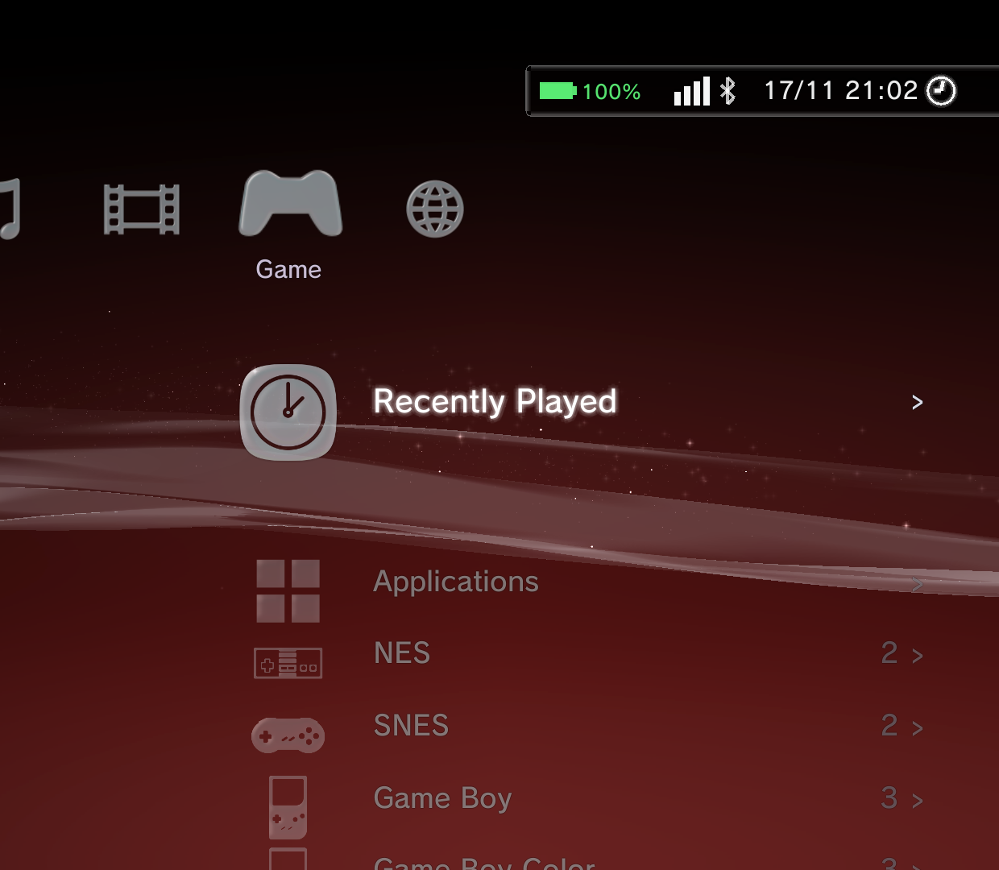

# GammaOS Nano for Retroid Pocket Classic

Unofficial development port of **GammaOS Nano 1.4.1 / GammaOS Core / Android 14**
for the original, four-button Retroid Pocket Classic (`parrot`, board ID `<0x22 0>`).
The port uses the original native Nano interface and emulator integration.

**Current checkpoint: `1.4.1-dev.23`.** Permanently installed and tested on one
original Classic. Off-mode battery animation, screen blank/wake and manual
long-Power return to Nano have been confirmed by the owner. USB OTG storage
remains untested. Rev Q (`<0x1000b 0>`) is not supported by this profile.

This repository integrates pinned public release images; it is **not a complete
AOSP source build**. It retains the Classic vendor/kernel and existing unlocked
bootloader. The resulting image uses an AVB integrity hashtree with authentication
`NONE`, not a production signing key. It is not an official Retroid or GammaOS release.



## Start here

- [Build the image](docs/BUILDING.md)
- [Update an existing installation / initial-install scope](docs/INSTALLING.md)
- [Hardware validation and known limits](docs/VALIDATION.md)
- [Integration architecture](docs/ARCHITECTURE.md)
- [NFS compatibility fixes](docs/NFS.md)
- [Prepare a GitHub publication](docs/PUBLISHING.md)
- [Коротко українською](docs/README.uk.md)

## What this port adds

- Classic display/audio routing, VNDK 32 integration and automatic controller startup.
- Fan/performance control and sleep handling using the retained vendor kernel.
- Quick Resume compatibility for RetroArch RZIP/RASTATE and native previews,
  including save synchronization before native Restart / Power Off.
- A dedicated off-mode charger service, original battery assets, required alarm
  capabilities, Qualcomm SDE atomic display handoff and actual panel backlight control.
- NFS READDIR linked-entry repair and conservative 32 KiB transfers for the tested
  UNFS3/libtirpc server. FTP, implicit FTPS, WebDAV and SMB scenarios were also tested.
- Guarded image integration, SHA256 input/output checks, dry-run installers,
  targeted system updates, diagnostics and host regression tests.

See the validation matrix for the exact scope. These results do not establish
compatibility with every game, NAS server, accessory or Classic hardware revision.

## Build and test

On Linux, install the [documented prerequisites](docs/BUILDING.md), then run:

```sh
python3 tools/prepare_references.py --download
python3 tools/prepare_android_tools.py --download
python3 tools/build_candidate.py --output out/port-1.4.1-dev.23
python3 -m unittest discover -s tests -v
```

The build downloads no user/device backup. Public upstream downloads have their
own SHA256 locks and remain outside Git. Tests without the reference image skip
the two checks that execute the pinned libnfs code; see [BUILDING](docs/BUILDING.md).

## Repository contents

| Path | Contents |
| --- | --- |
| `device/` | Init services, hardware scripts, policy delta and charger/NFS adapters |
| `tools/` | Input preparation, image integration, device collection, update and release tools |
| `tools/android/` | Java helpers and an optional physical diagnostics APK |
| `tests/` | Host tests, C kernel-interface mocks and arm64 decoder regression harness |
| `patches/` | Source equivalents and pinned upstream adaptation patches |
| `release/` | Public checkpoint metadata, hashes and draft release notes |
| `docs/` | Build, installation, architecture, validation and publishing instructions |

Device dumps, credentials, personal serial numbers, ROMs, saves, firmware images
and development session history are excluded. Images belong in release assets,
not Git history. The release tool splits the sparse image into 1 GiB parts and
records each checksum for verified reassembly.

## Credits and licensing

Based on [TheGammaSqueeze/GammaOSNext](https://github.com/TheGammaSqueeze/GammaOSNext)
and the pinned public Classic/GKD release inputs in `release-inputs.json`.
Original project code is licensed under [Apache-2.0](LICENSE); existing file
notices and upstream licenses continue to apply. See [THIRD_PARTY_NOTICES](THIRD_PARTY_NOTICES.md).
This source license does not relicense the downloaded Android images, vendor
firmware, applications, emulator cores or other upstream components.

